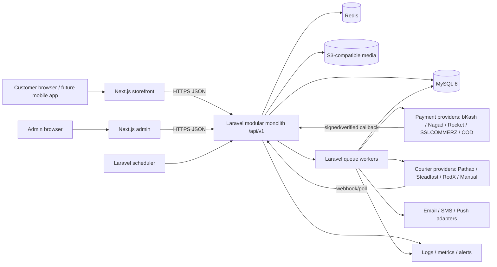

# System Architecture

## Architecture decision

Use an API-first modular monolith. Laravel owns all authoritative business rules and persistence; Next.js provides two logical applications (storefront and admin) that consume the versioned API. MySQL is the source of truth, Redis provides cache/queue/rate-limit primitives, and S3-compatible storage holds media. Keep modules in one deployable backend initially, with explicit interfaces and ownership.

This is a target architecture, not a description of the current PHP/SQLite implementation. Preserve the current app until migration and cutover are approved.

## Context and container diagram



## Module boundaries and ownership

| Module | Owns | Depends on |
|---|---|---|
| Identity & Access | users, roles, permissions, sessions/tokens, MFA | shared settings/audit |
| Customers | profile, addresses, devices, consent/preferences | identity |
| Catalog | categories, brands, products, variants, attributes, media, SEO | storage |
| Inventory | warehouses, stock, movement ledger, reservations | catalog, orders |
| Cart & Wishlist | guest/auth carts, lines, wishlist | catalog, inventory read |
| Checkout | checkout session, shipping quote, coupon quote, idempotency | cart, inventory, shipping, promotions |
| Orders | snapshots, state transitions, timeline, returns | checkout, inventory |
| Payments | adapters, attempts/events, verification, refunds/reconciliation | orders, queue, audit |
| Shipping | zones/rates, couriers, shipments/events, COD/RTO | orders, queue |
| Promotions | coupon/campaign eligibility and usage | catalog, orders |
| Reviews | eligibility, moderation, ratings | customers, orders, catalog |
| CMS & SEO | pages, banners, menus, posts, sitemap data | catalog, storage |
| Notifications | templates, preferences, delivery logs/retries | queue, identity/orders |
| Support | tickets and messages | customers, orders |
| Reporting | read-optimized queries/exports | domain read models |
| Audit & Settings | audit/activity logs, business/provider settings | all modules emit events |

Modules communicate through application services and domain events, not direct cross-module table edits from controllers. Keep transaction boundaries around a use case; write an outbox record in the same transaction for reliable asynchronous events if queue publishing can fail.

## Request and integration flow

1. Browser/mobile sends HTTPS request to `/api/v1`.
2. Laravel middleware resolves locale, correlation ID, rate limits, authentication, and authorization.
3. Form Request validates input; application action executes domain logic.
4. MySQL transaction persists authoritative state and outbox/audit entries.
5. API Resource returns a stable JSON contract; slow provider work is queued.
6. Queue worker uses provider adapter, idempotency key, bounded retry/backoff, and records result.
7. Verified provider webhook is authenticated, deduplicated, and reconciled with current state.

## Frontend structure

```text
frontend/
  apps/storefront/app|components|features|services|lib|types
  apps/admin/app|components|features|services|lib|types
  packages/ui|api-client|validation|types|config
```

Public catalog pages use server rendering/revalidation; interactions use client components only as needed. Admin navigation is permission-aware for UX, while Laravel remains the authorization boundary.

## Deployment topology

Nginx/TLS → Next.js storefront/admin runtimes and Laravel PHP-FPM API → MySQL/Redis/private object storage. Separate queue worker and scheduler processes. CI builds/tests images, scans dependencies, and deploys an immutable release to staging before production approval.

## Assumptions and dependencies

Start with one backend deployment and one primary database; define interfaces for later scaling. Exact cache strategy, frontend domain topology, object-store vendor, queue driver, and availability architecture depend on hosting/provider decisions.
