# Database ER Diagram and Integrity Strategy

## Core ER diagram

Products are catalog entries; `product_variants` are the sellable/inventory unit. A product without customer-selectable options still has one default variant. Cart lines, stock, reservations, movements, and order lines reference that variant so the inventory model has no variant-less path.

```mermaid
erDiagram
  USERS ||--o| CUSTOMER_PROFILES : has
  USERS ||--o{ CUSTOMER_ADDRESSES : saves
  USERS ||--o{ CUSTOMER_DEVICES : registers
  USERS }o--o{ ROLES : assigned
  ROLES }o--o{ PERMISSIONS : grants
  CATEGORIES ||--o{ PRODUCTS : categorizes
  CATEGORIES o|--o{ CATEGORIES : parent_of
  BRANDS o|--o{ PRODUCTS : brands
  PRODUCTS ||--o{ PRODUCT_VARIANTS : offers
  PRODUCTS ||--o{ PRODUCT_IMAGES : displays
  PRODUCT_VARIANTS ||--o{ PRODUCT_IMAGES : variant_media
  ATTRIBUTES ||--o{ ATTRIBUTE_VALUES : defines
  PRODUCTS }o--o{ ATTRIBUTE_VALUES : describes
  WAREHOUSES ||--o{ INVENTORY_STOCKS : stores
  PRODUCT_VARIANTS ||--o{ INVENTORY_STOCKS : stocked_as
  PRODUCT_VARIANTS ||--o{ STOCK_MOVEMENTS : moved
  PRODUCT_VARIANTS ||--o{ STOCK_RESERVATIONS : reserved
  USERS o|--o{ CARTS : owns
  CARTS ||--o{ CART_ITEMS : contains
  PRODUCT_VARIANTS ||--o{ CART_ITEMS : selected
  USERS ||--o{ WISHLISTS : owns
  WISHLISTS ||--o{ WISHLIST_ITEMS : contains
  PRODUCTS ||--o{ WISHLIST_ITEMS : saved
  CARTS ||--o{ CHECKOUT_SESSIONS : checks_out
  SHIPPING_ZONES ||--o{ SHIPPING_RATES : prices
  USERS o|--o{ ORDERS : places
  CHECKOUT_SESSIONS o|--o| ORDERS : creates
  ORDERS ||--|{ ORDER_ITEMS : snapshots
  ORDERS ||--|{ ORDER_ADDRESSES : snapshots
  ORDERS ||--o{ ORDER_STATUS_HISTORIES : records
  ORDERS ||--o{ PAYMENTS : attempts
  PAYMENTS ||--o{ PAYMENT_TRANSACTIONS : records
  PAYMENTS ||--o{ REFUNDS : refunds
  PAYMENTS ||--o{ PAYMENT_WEBHOOK_EVENTS : receives
  ORDERS ||--o{ COURIER_SHIPMENTS : fulfills
  COURIERS o|--o{ COURIER_SHIPMENTS : books
  COURIER_SHIPMENTS ||--o{ SHIPMENT_EVENTS : tracks
  COUPONS ||--o{ COUPON_USAGES : redeemed
  ORDERS ||--o{ COUPON_USAGES : applies
  PRODUCTS ||--o{ PRODUCT_REVIEWS : reviewed
  USERS ||--o{ PRODUCT_REVIEWS : writes
  ORDER_ITEMS ||--o| PRODUCT_REVIEWS : verifies
  MENUS ||--o{ MENU_ITEMS : contains
  USERS o|--o{ SUPPORT_TICKETS : opens
  SUPPORT_TICKETS ||--o{ SUPPORT_MESSAGES : contains
  USERS ||--o{ NOTIFICATIONS : receives
  USERS o|--o{ AUDIT_LOGS : acts
```

`ORDERS`, `PAYMENTS`, `REFUNDS`, `STOCK_MOVEMENTS`, `PAYMENT_WEBHOOK_EVENTS`, `SHIPMENT_EVENTS`, and `AUDIT_LOGS` are intentionally historical records. Their financial/audit integrity takes precedence over catalog cleanup.

## Indexing plan

- Unique: normalized user email/phone, role slug, permission key, category/brand/product slug, product SKU, variant SKU, order number/public ID, provider transaction/event IDs, coupon code, shipment consignment/provider reference, idempotency scopes, ticket number.
- Catalog: `(status, category_id, created_at)`, `(brand_id,status)`, variant `(product_id,is_active)`, product image `(product_id,sort_order)`. Search implementation is a decision: MySQL FULLTEXT first; external search only after measured need.
- Inventory: unique `(warehouse_id,product_variant_id)`; `(product_variant_id,warehouse_id)`; reservation `(status,expires_at)` and `(order_id,status)`; movement `(product_variant_id,created_at)` and reference.
- Orders: `(user_id,created_at)`, `(order_status,created_at)`, `(payment_status,created_at)`, `(fulfillment_status,created_at)`, `(phone_hash,order_number)` if phone-based guest tracking is approved.
- Payments/couriers: `(order_id,created_at)`, `(provider,status,created_at)`, `(courier_id,status,created_at)`, external reference unique.
- Operational tables: ticket `(status,assigned_to,updated_at)`, notifications `(user_id,read_at,created_at)`, audit `(actor_user_id,created_at)` and `(subject_type,subject_id,created_at)`.

Add indexes based on `EXPLAIN ANALYZE` and production query telemetry; avoid redundant indexes on high-write ledger tables.

## Constraints and transaction boundaries

1. `CHECK` nonnegative money/quantity, `reserved <= on_hand`, positive order quantity, rating 1..5; application validation mirrors DB constraints.
2. Checkout transaction locks/conditionally reserves each variant, creates order/item/address snapshots, coupon usage and state history, and persists idempotency outcome.
3. Refund transaction locks payment, sums successful/pending refunds, reserves refundable balance, and records one idempotent request before calling provider asynchronously.
4. Webhook dedupe unique key persists receipt before processing; state transition is idempotent and amount/currency/provider reference must match.
5. Stock transfer records outbound/inbound movements atomically; adjustment requires actor and reason.
6. FK deletion: financial/audit/order history RESTRICT; dependent items cascade only when parent has no durable business history; user/product references on snapshots become nullable rather than deleting the snapshot.
7. Nullable unique columns and MySQL semantics need migration tests; normalize identifiers before uniqueness checks.

## Open decisions

Primary key strategy BIGINT is recommended for the first release; opaque public ULIDs prevent enumeration. Approve before migrations. Select full-text search strategy and historical retention policy before scale testing.
